# Labs64.IO :: Payment Gateway

**One API for every payment provider: charged once, never twice.**
*Part of the [Labs64.IO Ecosystem](https://labs64.io): the payments layer your shop, app or billing service calls.*

[**Get started**](https://labs64.io/docs/modules/payment-gateway/#quick-start) · [Features](#features) · [Architecture](https://labs64.io/docs/modules/payment-gateway/#architecture) · [AI agents](#using-it-with-ai-agents) · [Ecosystem](#the-labs64io-ecosystem) · [Documentation](https://labs64.io/docs/modules/payment-gateway/) · [labs64.io](https://labs64.io)

> [!NOTE]
> Stripe, PayPal and a NoOp test provider ship in the box; add your own through the provider SPI. Every provider is configured **per tenant**, so one deployment can serve many merchants.

## Why Payment Gateway?

Adding a payment provider is easy. Living with three of them is not: different APIs, different webhook formats, different failure modes, and a double charge is always one network timeout away. Payment Gateway gives your applications one contract and keeps the provider-specific mess behind it.

1. **One REST API.** Create a payment, pay it, read the result: the same calls for Stripe, PayPal or a provider you add yourself.
2. **Safe to retry.** Pay with an `Idempotency-Key` and a replay returns the original transaction instead of charging again.
3. **One result shape.** Provider responses and webhooks are normalized into the same payment and transaction states, so your code does not care who processed the money.

- You have one provider and one application and are happy with its SDK: the abstraction would be overhead.
- You need a hosted storefront, subscriptions billing UI or invoicing: this is the payment API layer, not a billing suite.

**A good fit if**

- You take payments through more than one provider, or expect to switch or add one without touching every application.
- Several applications or merchants (tenants) need payments, and you want credentials and rules kept per tenant.
- You want payment lifecycle events in your audit trail without writing the glue.

**Probably not what you need if**

- You have one provider and one application and are happy with its SDK: the abstraction would be overhead.
- You need a hosted storefront, subscriptions billing UI or invoicing: this is the payment API layer, not a billing suite.

## Features

- **Provider abstraction**: one `PaymentProvider` SPI; Stripe, PayPal and NoOp ship as modules, and adding a PSP is a new module, not a fork.
- **Idempotent payments**: Redis-backed `Idempotency-Key` handling; a replay returns the first result.
- **Webhooks and returns**: PSP webhooks and browser returns are handled per provider; terminal transactions are never overwritten by a late event.
- **Multi-tenant**: tenant, scopes and provider credentials come from the trusted gateway headers and per-tenant provider config.
- **Payment lifecycle events**: `payment.created`, `payment.finalized` and `payment.closed` can be published to AuditFlow over its HTTP API.
- **Recurring payments**: a payment can carry a recurrence rule (duration or cron).
- **OpenAPI-first**: the contract is the source of truth; models and server interfaces are generated from it.
- **Observable**: Actuator health, Micrometer tracing over OTLP and a Prometheus endpoint.

The complete list is in the [documentation](https://labs64.io/docs/modules/payment-gateway/).

## Before you take real payments

The Docker path above is for evaluation. A few things matter before real money flows:

- **Put it behind the API Gateway.** The service trusts the `X-Auth-*` headers it receives; without a gateway that authenticates callers, anyone who can reach it can claim any identity.
- **Protect provider credentials.** They live in each tenant's provider configuration: restrict who can read and write `/payment-providers`, and keep the database encrypted and backed up.
- **Make webhooks reachable and verified.** Providers must be able to reach `/providers/{provider}/webhooks`, and each provider's signing secret must be configured so signatures are checked.
- **Test with the provider's sandbox first.** Stripe and PayPal both have test modes; the [demo runbook](examples/payment-gateway-stripe-paypal-demo.md) walks through them.
- **Always send an `Idempotency-Key`** from the code that calls `pay`.

## Using it with AI agents

The API is safe to retry with an `Idempotency-Key`, and the OpenAPI spec is enough to generate a client or tool definition. The [guide for AI agents](https://labs64.io/docs/introduction/ai-agents.html) covers authentication, retries and errors across all modules. Working on this repository with an agent? [`AGENTS.md`](AGENTS.md) and [`CLAUDE.md`](CLAUDE.md) describe the layout, conventions and test commands.

## The Labs64.IO Ecosystem

Payment Gateway is one module of the [Labs64.IO Ecosystem](https://labs64.io); [every module is documented here](https://labs64.io/docs/).

| Module | What it does | Link |
|---|---|---|
| **AuditFlow** | Audit-event routing pipeline | [labs64.io-auditflow](https://github.com/Labs64/labs64.io-auditflow) |
| **API Gateway** | Authenticating, policy-enforcing edge for all modules | [labs64.io-authproxy](https://github.com/Labs64/labs64.io-authproxy) |
| **Payment Gateway** | One API over multiple payment providers | [labs64.io-payment-gateway](https://github.com/Labs64/labs64.io-payment-gateway) |
| **Checkout** | Embeddable, brandable checkout | [labs64.io-checkout](https://github.com/Labs64/labs64.io-checkout) |
| **Reporting** | Read-only reports over the events AuditFlow stored | [labs64.io-reporting](https://github.com/Labs64/labs64.io-reporting) |
| **Customer Portal** | Customer self-service UI | [labs64.io-customer-portal](https://github.com/Labs64/labs64.io-customer-portal) |
| **Commons** | Shared Java and Python libraries | [labs64.io-commons](https://github.com/Labs64/labs64.io-commons) |
| **Helm Charts** | Kubernetes deployment for every module | [labs64.io-helm-charts](https://github.com/Labs64/labs64.io-helm-charts) |
| **Workspace** | Dev container and multi-repo tooling | [labs64.io-workspace](https://github.com/Labs64/labs64.io-workspace) |
| **Tests** | Cross-module regression suite | [labs64.io-tests](https://github.com/Labs64/labs64.io-tests) |
| **Docs** | Published documentation | [labs64.io-docs](https://github.com/Labs64/labs64.io-docs) |
| **NetLicensing** | Licensing-as-a-Service: license and entitlement management | [netlicensing.io](https://netlicensing.io) |
| **GuideChimp** | Interactive guided product tours | [labs64.com/guidechimp](https://www.labs64.com/guidechimp/) |

## Contributing

We would love your help. The most valuable contribution is a new payment provider. Fork the repository, make your change on a branch, run the checks described in [`AGENTS.md`](AGENTS.md) and open a pull request. Start from the SPI in [`payment-gateway-providers/providers-spi`](payment-gateway-providers/providers-spi/) and the `noop` module as a template. Not sure whether an idea fits? Open an issue first and we will talk it through; that is a perfectly good way to start.

## License

Everything in this repository is open source under the [Apache License 2.0](LICENSE): you can use it, change it and ship it commercially. The core of the *Labs64.IO Ecosystem* is free forever; community modules are Apache-2.0 licensed.

---

   
  Made by the <a href="https://labs64.io">Labs64</a> team and community.

